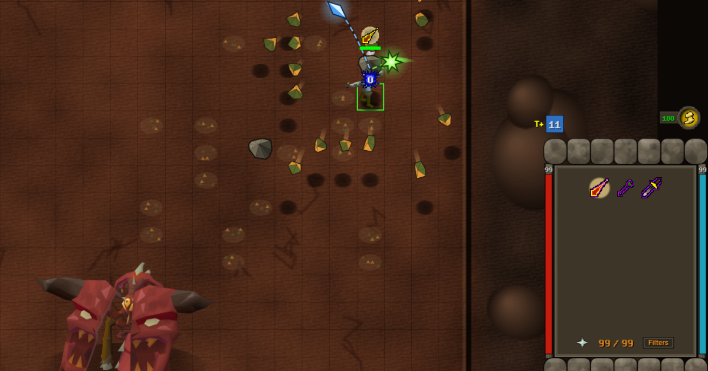

# Double Rock Sim

Practice Doom delve 8+ double rocks.

**Play it at https://double-rock-sim.pages.dev**



A browser practice tool for the double rock (also called double boulder) at the Doom of Mokhaiotl in Old School RuneScape. On delve 8 and deeper, Doom throws two rocks three ticks apart. Dodge both boulders and both debris showers, then pray against the six-hit barrage. A rep with no damage is clean.

## Controls

| Action | Input |
| --- | --- |
| Walk | Click |
| Walk 1 tile per tick | Ctrl + Click |
| Pray | Click a prayer in the prayer book |
| Toggle run | Click the run orb |
| Pause | Space |
| Next tick (while paused) | `.` |

## Features

- The prayer book uses the in-game layout. **Arrange prayers** moves the three protection prayers to any slot to match your own book.
- Real hitpoints mode ends the run at 0 HP. Practice mode keeps you on 1 HP and tells you when a hit would have killed you.
- The Last rep report shows how you exited each rock, what landed on you and each barrage hit. Session stats track clean reps, your streak, and damage taken and times hit from debris, boulders and the barrage.
- A tick ruler, a tick log, pausing and single-tick stepping.
- Tile markers, hints, camera, zoom and sound are all in Settings. Settings and stats are saved in your browser.

## Timings

Times are in game ticks of 0.6 s. T is the tick Doom throws rock 1.

| Tick | What happens |
| --- | --- |
| T | Rock 1 is thrown |
| T+3 | Rock 2 is thrown |
| T+6 | Rock 1 dips |
| T+7 | Rock 1 bursts. Your overhead prayer turns off, a boulder is aimed at the tile you're on, and debris shadows appear in the 9x9 around you |
| T+9 | Rock 1's boulder and debris land. Rock 2 dips |
| T+10 | Rock 2 bursts |
| T+11 to T+16 | The barrage: six hits in the order X Y X X Y X, where X is the rock's style (blue rock: Magic, green rock: Ranged) |
| T+12 | Rock 2's boulder and debris land |

A boulder that lands on you pushes you to a random tile next to it and stays on the floor. Rock 2's debris never lands on rock 1's debris tiles. On each tick the sim handles your clicks first, then Doom and the falling rocks, then your movement.

These timings come from the [OSRS Wiki](https://oldschool.runescape.wiki/w/Doom_of_Mokhaiotl) and a frame-by-frame count of the wiki's delve 8 clip. Some values are estimates: about 18 debris tiles per rock, the damage rolls (15 to 21 per rock, 15 to 65 per unprayed barrage hit) and the 2-tick stun after a boulder push.

## Running it locally

Download `site/index.html` and open it in a browser. Everything runs on your own machine.

## Building

`template.html` is the page source. `build-assets.json` holds the game sprites, packed as data URIs.

```sh
python tools/build.py template.html build-assets.json double-rock-sim.html
python tools/build_site.py double-rock-sim.html build-assets.json site https://double-rock-sim.pages.dev/
```

The first command builds the bare page. The second wraps it as a complete web page in `site/`, with the link-preview tags that Discord and Reddit read. These scripts need only the Python standard library.

`tools/build_assets.py` rebuilds `build-assets.json` from sprite files downloaded from the OSRS Wiki. It needs `opencv-python-headless` and `numpy`.

## Tests

```sh
bash tools/run_tests.sh
```

This builds the page, appends `test/harness-tail.html` and runs it in headless Chrome. The harness steps the sim tick by tick and runs 94 checks covering timings, damage, prayers, the camera, saved settings and the page panels. If Chrome isn't at its usual Windows path, set `CHROME` to its location. Set `PYTHON` to choose the interpreter.

`test/shot-tail.html` freezes a scenario for screenshots. Append it to the built page and open the result with a hash such as `#barrage`.

## License

The code is released under the MIT License. See [LICENSE](LICENSE).

The game sprites and renders in `build-assets.json` and in the built pages are the property of Jagex Ltd. They were taken from the [OSRS Wiki](https://oldschool.runescape.wiki/) and are not covered by the MIT License.

This is an unofficial fan project. It is not endorsed by or affiliated with Jagex.
